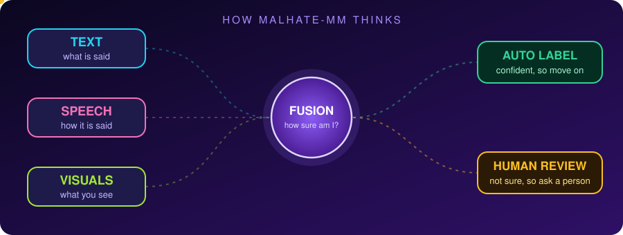

<div align="center">




<br/>

<a href="mailto:balananujith@gmail.com"></a>
<a href="https://linkedin.com/in/balananujith"></a>
<a href="https://github.com/balananujith"></a>

</div>


## 🎯 PICK YOUR PLAYER

Short on time? Open the one that sounds like you. 👇

<details>
<summary><b>🧑‍💼 I'm a recruiter / hiring manager</b></summary>

<br/>

**10-second version:**
- 🎓 M.Tech CSE student at Pondicherry University (2025 to 2027), B.Tech CSE from UCE Kariavattom (2024)
- 🐍 Python first, plus C++, C, Java, JavaScript
- 🤖 Hands-on with ML, deep learning (CNNs), NLP and multimodal AI
- 💼 ML Intern at iNeuron, HackerRank Software Engineer Intern certified
- 👑 Led student teams on two projects and shipped both
- 🥇 Medal + Best Performer certificate at the Smart India Hackathon internal round (team)
- 📬 Open to software and AI roles: [balananujith@gmail.com](mailto:balananujith@gmail.com)

</details>

<details>
<summary><b>🤝 I'm a collaborator / researcher</b></summary>

<br/>

I'm working on **multimodal hate and offensive content detection for Malayalam videos**, combining text, speech and visuals, with an **uncertainty-aware fusion** step that sends shaky predictions to humans.

Into low-resource language AI, video understanding or human-in-the-loop systems? Let's talk. 💬

</details>

<details>
<summary><b>🎓 I'm a student who wants to learn</b></summary>

<br/>

Start here:
1. 📊 Build something visual (my Algorithm Visualizer taught me more than any textbook)
2. 🎬 Make a small recommender app with Flask
3. 🧠 Then try a CNN on video frames

Ask me anything, I like explaining things with analogies. 🙌

</details>

<details>
<summary><b>🍔 Secret menu</b></summary>

<br/>

```bash
$ sudo hire anujith
[sudo] password for recruiter: ********
✔ Permission granted.
✔ Next step: email balananujith@gmail.com
```

</details>


## 🎮 CHARACTER SHEET

<div align="center">

| 🧙 CLASS | 🌍 HOME BASE | 🗣️ LANGUAGES UNLOCKED |
|:---:|:---:|:---:|
| **AI Builder** | Kerala, India 🇮🇳 | English · Malayalam · Hindi · Tamil *(beginner)* |

</div>

```text
╔════════════════════════════════════════════════════╗
║  ANUJITH BALAN                      LVL: M.Tech 🎓 ║
╠════════════════════════════════════════════════════╣
║  🐍 Python ............ ▰▰▰▰▰▰▰▰▰▰  MAIN WEAPON    ║
║  🧠 ML / Deep Learning  ▰▰▰▰▰▰▰▰▱▱                 ║
║  👁️ Video + CNN ....... ▰▰▰▰▰▰▰▰▱▱                 ║
║  🗣️ NLP ............... ▰▰▰▰▰▰▰▱▱▱                 ║
║  ⚙️ C++ / Java / JS ... ▰▰▰▰▰▰▱▱▱▱                 ║
║  🌐 Flask / Django .... ▰▰▰▰▰▰▱▱▱▱                 ║
║  ☕ Dark mode ......... ▰▰▰▰▰▰▰▰▰▰  (light = bugs 🐛)║
╠════════════════════════════════════════════════════╣
║  QUEST LOG: MalHate-MM 🎥          STATUS: ACTIVE  ║
╚════════════════════════════════════════════════════╝
```


## 🔥 BOSS FIGHT: MalHate-MM

> *Hate speech doesn't always shout. Sometimes it smiles and says the opposite of what it means.*

Most detectors only **read** text. But a video speaks in **three ways at once**: words, voice, and what's on screen. Sarcasm hides in the gap between them.

<div align="center">



</div>

**Think of it like a courtroom ⚖️**
Three witnesses (text, speech, visuals) give statements. The judge (the fusion model) weighs them. If they disagree and the judge isn't sure, the case goes to a human instead of a guess.

<details>
<summary><b>🕵️ Click to try: can YOU spot the sarcasm?</b></summary>

<br/>

Someone posts a video with the caption **"Wow, amazing service 👏"**

Their face is flat. Their voice is dripping with annoyance. The clip shows a 3-hour queue.

- 📝 **Text says:** positive ✅
- 🎙️ **Voice says:** angry 😒
- 👁️ **Video says:** nope 🙃

A text-only model says "nice review!" 🤦
A multimodal model notices the three signals disagree.

**That mismatch is exactly what MalHate-MM is built to find, in Malayalam.**

</details>

**What I'm building:**
- 🎬 A **labelled Malayalam video dataset**
- 🧠 An **uncertainty-aware fusion framework**
- 🙋 A **human-in-the-loop** step for low-confidence clips


## 🗺️ SIDE QUESTS

<table>
<tr>
<td width="50%" valign="top">

### 🕵️ Video Truth Sentinel
`MISSION: catch the fakes` · ✅ **COMPLETED**

CNN system that checks videos **frame by frame** for fake or manipulated content.
I led the team: split tasks, tracked progress, shipped it end to end.

`CNN` `Deep Learning` `Video Analysis`
**Role:** 👑 Team Leader · B.Tech Major

</td>
<td width="50%" valign="top">

### 📺 YouTube Video Summarizer
`MISSION: skip the 40 min intro` · ✅ **COMPLETED**

Paste a video, get a short summary. Grabs the transcript, lets Gemini do the squeezing.

`Python` `Gemini API` `YouTube Transcript API`
**Type:** 🤖 GenAI tool

</td>
</tr>
<tr>
<td width="50%" valign="top">

### 📊 Algorithm Visualizer
`MISSION: make sorting watchable` · ✅ **COMPLETED**

Desktop app that shows every step of sorting and searching. Change array size, pause, resume, reset.

`Python` `Tkinter`
**Role:** 👑 Team Leader · B.Tech Mini

</td>
<td width="50%" valign="top">

### 🎬 Movie Recommender
`MISSION: end "what do we watch?"` · ✅ **COMPLETED**

Tell it what you like, it picks what's next.

`Python` `Flask` `HTML` `CSS` `JS`
**Type:** 🌐 Web app

</td>
</tr>
</table>


## 🧰 INVENTORY

<div align="center">


🧠 **Core stuff:** DSA · OOP · Operating Systems · Computer Networks · DBMS · SDLC · MVC

</div>


## 📜 PATCH NOTES

```diff
# anujith.changelog

+ v2020  Started B.Tech CSE at University College of Engineering, Kariavattom
+ v2023  Data Science workshop at NIT Calicut
+ v2023  ML Intern at iNeuron (Aug to Nov): shipped a Book Recommendation System
+ v2023  Smart India Hackathon internal round: medal + Best Performer (team)
+ v2024  HackerRank Software Engineer Intern certification (June)
+ v2024  Graduated B.Tech, shipped Video Truth Sentinel as team leader
+ v2025  Started M.Tech CSE at Pondicherry University
+ v2025  Launched MalHate-MM, still in active development

- known issue: AI models that miss sarcasm
! patch in progress: multimodal fusion + human review
```

<details>
<summary><b>🛠️ Workshops I've leveled up in</b></summary>

<br/>

- 🔍 Cyber Forensics (NSS UCEK with CDAC)
- 📊 Data Science (NIT Calicut, 2023)
- ☁️ Cloud Computing (Mar Athanasius College of Engineering)
- ⚛️ Web Development with React (Alchemy IEDC, College of Engineering Attingal)

</details>

<details>
<summary><b>🤝 Beyond code</b></summary>

<br/>

Member of the **National Service Scheme (NSS)**, doing community service activities.

</details>


## 🏆 TROPHY SHELF

<div align="center">


<br/>


</div>


## 📡 SIGNAL ME

I'm looking for software and AI roles where I can ship reliable, well-tested work and keep learning in a fast team. If you've got a problem, a collab idea, or just want to nerd out on multimodal AI, ping me. 👋

<div align="center">

<a href="mailto:balananujith@gmail.com"></a>
<a href="https://linkedin.com/in/balananujith"></a>

<br/><br/>


</div>
