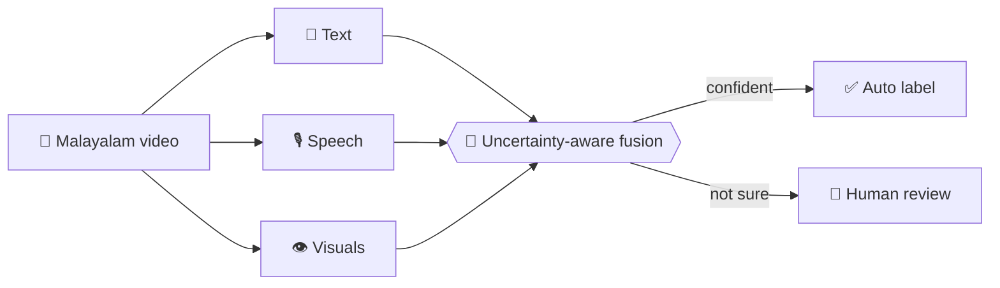

<div align="center">


<br/>

[](mailto:balananujith@gmail.com)
[](https://linkedin.com/in/balananujith)
[](https://github.com/balananujith)

</div>

---

## 🪪 Player Card

```python
class AnujithBalan:
    role      = "M.Tech CSE student · AI builder"
    campus    = "Pondicherry University (2025 – 2027)"
    origin    = "Kerala, India 🇮🇳"
    main_lang = "Python 🐍"          # C++, C, Java, JS on the bench
    speaks    = ["English", "Malayalam", "Hindi", "Tamil (beginner)"]
    superpower = "Turning messy video, audio & text into something a model can understand"
    current_quest = "MalHate-MM 🎥"
    status    = "Open to internships, collabs & good problems"
```

---

## 🔥 Main Quest: MalHate-MM

> *Hate speech doesn't always shout. Sometimes it smiles, jokes, and says the opposite of what it means.*

Most detectors only read text. But a Malayalam video can say one thing in words, another in tone, and something else on screen. **Sarcasm lives in that gap.**

So I'm building a system that watches, listens and reads, all at once. 👇



**Think of it like a courtroom 🧑‍⚖️** Three witnesses (text, speech, visuals) give their statements. The judge (fusion model) weighs them. If the witnesses disagree and the judge isn't sure, the case goes to a human instead of guessing.

- 🎬 Creating a **labelled Malayalam video dataset**
- 🧠 Designing an **uncertainty-aware fusion framework**
- 🙋 Low-confidence clips get **routed to human review**
- 🎯 Target: the hard cases, like sarcasm

---

## 🗺️ Side Quests

<table>
<tr>
<td width="50%" valign="top">

### 🕵️ Video Truth Sentinel
**B.Tech Major Project · Team Leader**

CNN-based system that checks videos **frame by frame** to spot fake or manipulated content. Led the team end to end: split tasks, tracked progress, shipped it.

`CNN` `Deep Learning` `Video Analysis`

</td>
<td width="50%" valign="top">

### 📺 YouTube Video Summarizer
**GenAI tool**

Paste a video, get a short summary. Pulls the transcript and lets Gemini do the condensing. Saves you from the 40-minute intro.

`Python` `Gemini API` `YouTube Transcript API`

</td>
</tr>
<tr>
<td width="50%" valign="top">

### 📊 Sorting & Searching Visualizer
**B.Tech Mini Project · Team Leader**

Desktop app that shows every step of sorting and searching algorithms. Adjustable array size, plus pause, resume and reset.

`Python` `Tkinter`

</td>
<td width="50%" valign="top">

### 🎬 Movie Recommendation System
**Web app**

Tell it what you like, it suggests what to watch next.

`Python` `Flask` `HTML` `CSS` `JS`

</td>
</tr>
</table>

---

## 🧰 Inventory

<div align="center">

### 🤖 AI · ML


### 💻 Languages


### 🌐 Web · Tools


### 🗄️ Databases


</div>

**🧠 Core fundamentals:** Data Structures & Algorithms · OOP · Operating Systems · Computer Networks · DBMS · SDLC · MVC

---

## 🏆 Level History

| 🗓️ When | 🎯 What |
|---|---|
| **2025 – 2027** | 🎓 M.Tech CSE, Pondicherry University *(in progress)* |
| **Jun 2024** | 🏅 HackerRank Software Engineer Intern Certification |
| **2020 – 2024** | 🎓 B.Tech CSE, University College of Engineering, Kariavattom |
| **Aug – Nov 2023** | 💼 Machine Learning Intern at **iNeuron**: built a Book Recommendation System |
| **Smart India Hackathon** | 🥇 Medal + Best Performer certificate (team, internal round) |

---

## 🎒 Side Items

- 🛠️ **Workshops:** Cyber Forensics (NSS UCEK with CDAC) · Data Science (NIT Calicut, 2023) · Cloud Computing (Mar Athanasius College of Engineering) · Web Development with React (Alchemy IEDC, CE Attingal)
- 🤝 **Community:** Member of the National Service Scheme (NSS)

---

## 📊 Stats

<div align="center">


</div>

---

## 💬 Let's build something

I'm looking for software and AI roles where I can ship reliable, well-tested work and keep learning in a fast-moving team. If you've got a problem, a collab idea, or just want to talk multimodal AI, say hi. 👋

<div align="center">

[](mailto:balananujith@gmail.com)
&nbsp;
[](https://linkedin.com/in/balananujith)


</div>
